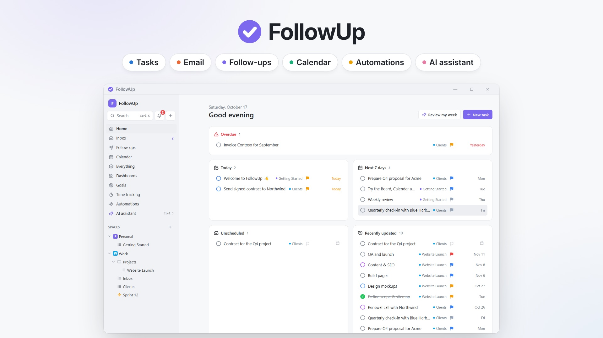
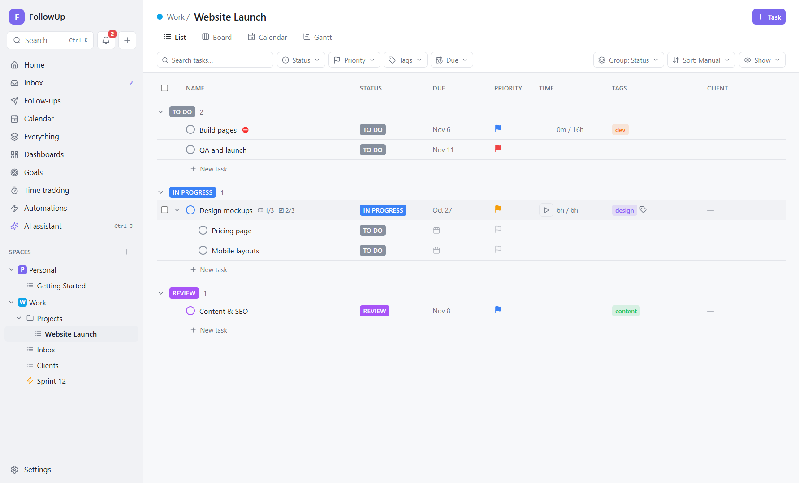
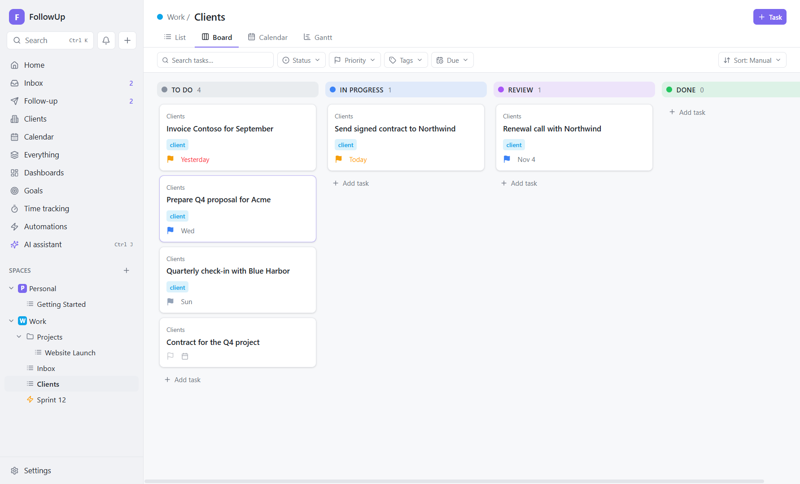
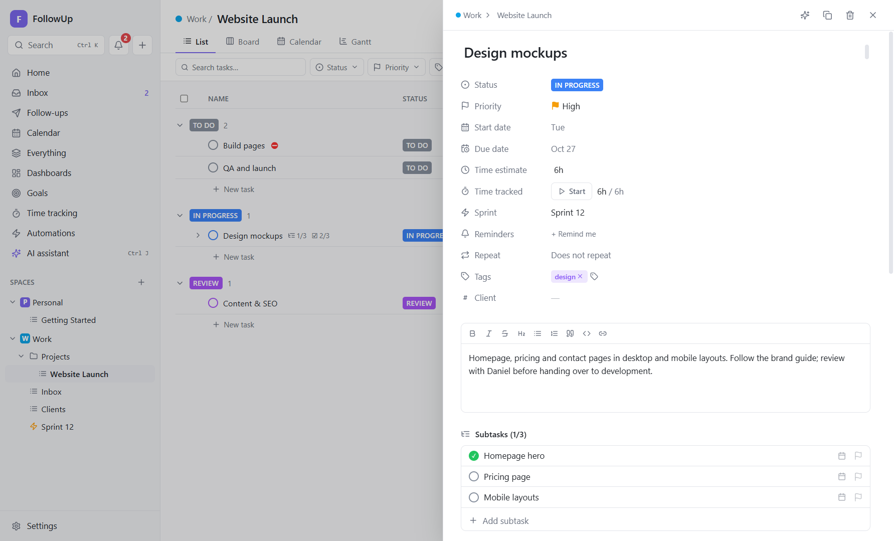
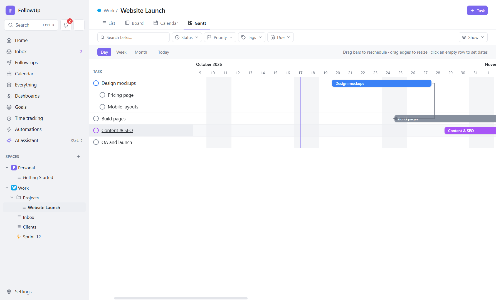
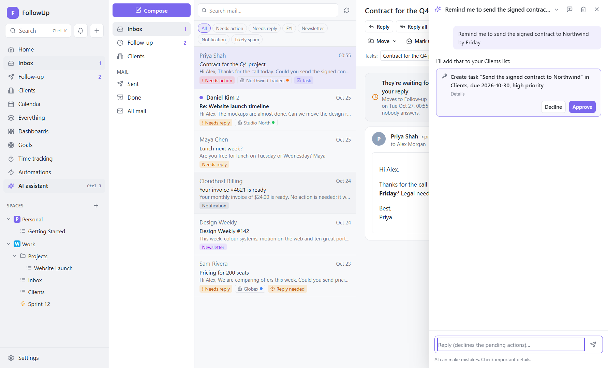
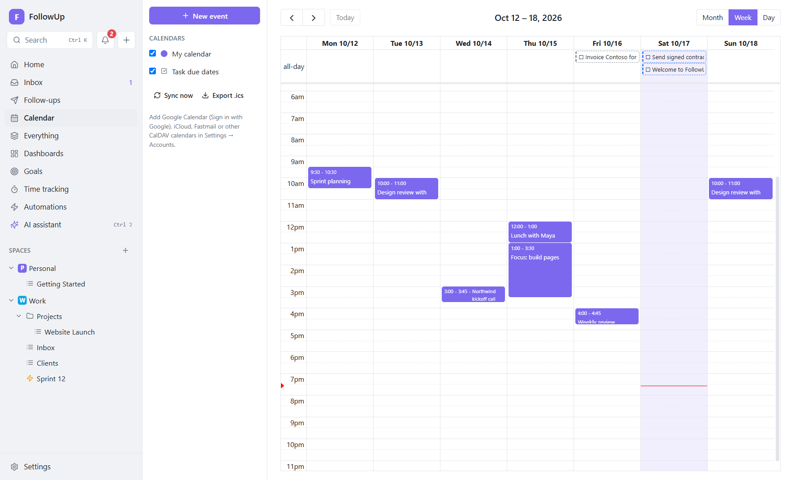
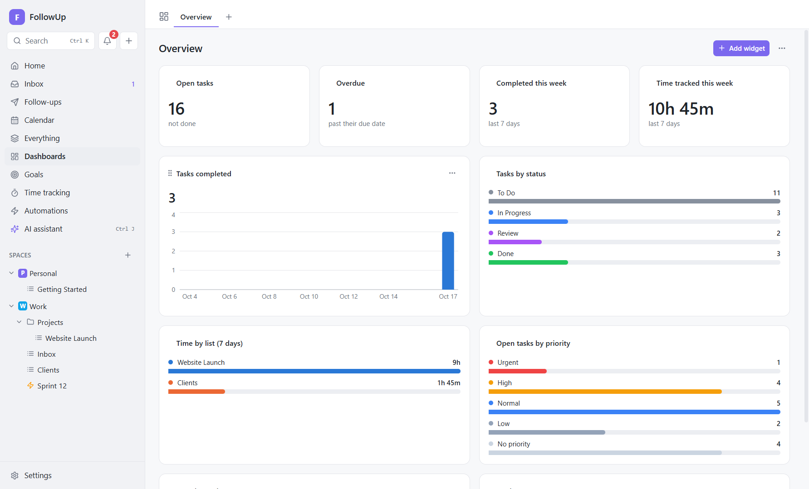
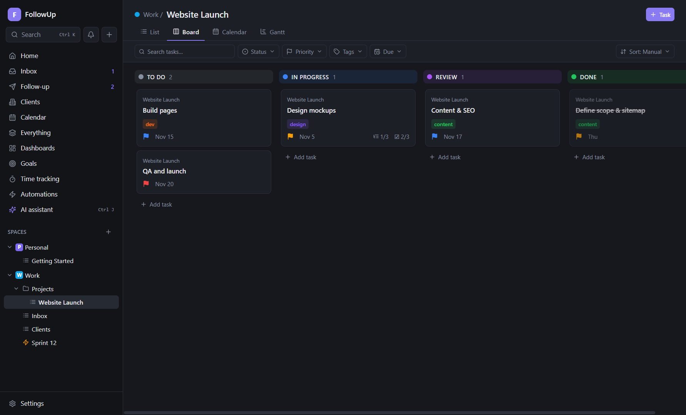
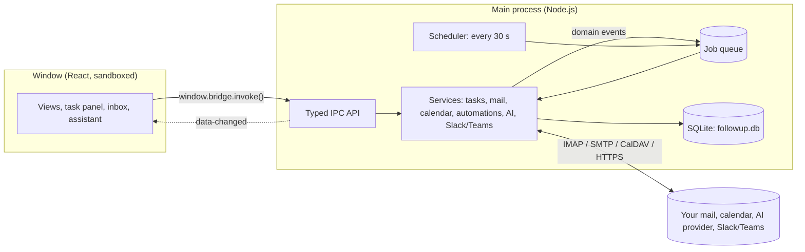

<div align="center">


# FollowUp

**Tasks, email follow-ups, calendar, automations and an AI assistant in one Windows app that keeps your data on your PC.**

[](https://github.com/miller-hack/FollowUp/actions/workflows/ci.yml)
[](https://github.com/miller-hack/FollowUp/releases/latest)
[](LICENSE)


[Download](https://github.com/miller-hack/FollowUp/releases/latest) ·
[User guide](docs/README.md) ·
[Report a bug](https://github.com/miller-hack/FollowUp/issues/new/choose) ·
[Request a feature](https://github.com/miller-hack/FollowUp/issues/new?template=feature_request.yml)


**▶ [Watch the 50-second tour](docs/video/followup-tour.mp4)**

<a href="docs/video/followup-tour.mp4"></a>

</div>

---

## Executive summary

**FollowUp** is a free, open-source work manager for Windows. It covers the jobs people usually spread across a task manager, an email client, a follow-up reminder tool, a calendar and an AI chatbot:

- plan work in **spaces, folders, lists and tasks**, viewed as a list, a Kanban board, a calendar or a Gantt chart;
- turn **email into tasks** with one click;
- let **follow-up sequences** chase people who haven't replied, stopping the moment they answer;
- automate routine work with a **no-code rules engine** ("when this happens, if that's true, do this");
- ask a **built-in AI assistant** that can read and update your workspace, but only changes things after you approve.

It's **local-first**. Everything lives in one SQLite database on your own PC, and the app works fully offline:
- **Network:** it contacts only the services you connect yourself (your mail server, calendar, Slack or Teams, the AI provider you choose).
- **No cloud account,** no telemetry and no subscription.
- **Passwords and API keys** are encrypted with Windows' own data protection (DPAPI).

**Who it's for:**
- freelancers and consultants who live in their inbox;
- small-business owners and sales people who need reliable follow-ups;
- project leads who want ClickUp-style planning without putting company data in someone else's cloud;
- anyone who wants to automate their own workflow and is happy to read (or change) the source.

## Contents

- [Features](#features)
- [Screenshots](#screenshots)
- [Download and install](#download-and-install)
- [Your first 10 minutes](#your-first-10-minutes)
- [Documentation](#documentation)
- [How it works](#how-it-works)
- [Build from source](#build-from-source)
- [Project structure](#project-structure)
- [Roadmap](#roadmap)
- [Reporting bugs and getting help](#reporting-bugs-and-getting-help)
- [Contributing](#contributing)
- [License](#license)

## Features

**Work management**
- Spaces → folders → lists → tasks → subtasks.
- Statuses per space, with a type (open / active / done).
- Task fields: priorities, start and due dates (with times), time estimates, tags and 12 kinds of custom fields.
- Inside a task: checklists, dependencies ("waiting on"), recurring tasks, reminders, comments, file attachments and a full activity log.
- **List** view: grouped by status, priority or due date, sorted, inline editing, bulk edit. It stays fast with thousands of tasks.
- **Board** (drag and drop), **Calendar** (drag to reschedule) and **Gantt** (drag and resize bars, dependency arrows).
- Saved filters per location, an "Everything" view and a "My Work" home page.
- Quick add (`Ctrl+N`) and a search and command palette (`Ctrl+K`).

**Email and follow-ups**
- Mail accounts:
  - Gmail and Google Calendar (sign in with Google)
  - Outlook / Microsoft 365 (sign in with Microsoft)
  - iCloud, Yahoo, Zoho, Fastmail or any IMAP/SMTP mailbox with an app password
- Threaded inbox with search, unread sync and safe reading: remote images and scripts are blocked, and dangerous attachments are never launched.
- **Email ↔ task links:** create a task from a thread, see linked emails inside the task.
- **Follow-up sequences:** "if nobody replies in 3 days, send this; 5 days later, send that." They respect send windows and daily limits, and stop on reply, bounce or your own reply.
- Email templates and a compose window that threads replies correctly.

**Calendar**
- A built-in calendar plus two-way sync with CalDAV calendars (Google Calendar, iCloud, Fastmail, Nextcloud…).
- Task due dates appear on the calendar.
- "Block time" turns a task into a calendar event.
- Export everything as an `.ics` file.

**Automations**
- 15 triggers, including:
  - task created, status changed, due date approaching, overdue
  - email received, no reply after N days, AI classified an email
  - calendar event starting soon, a schedule
- 12 condition fields and 20 actions, including:
  - change status, priority or due date; add a checklist; create tasks
  - send or reply to email; start a follow-up sequence
  - notify me; post to Slack or Teams; ask the AI
- Template library, dry-run testing against a real task or email, run history and loop protection.

**AI (optional, bring your own key)**
- Providers: Anthropic Claude, OpenAI, or a **local Ollama model** that runs offline.
- **Assistant** (`Ctrl+J`): looks things up in your tasks, email, calendar, time and goals. It proposes changes as approval cards and never sends email by itself.
- In tasks: summarize a task, suggest subtasks, rewrite text.
- Natural-language quick add: *"call Sam next Tue 3pm, urgent #sales"*.
- In email: summarize a thread, draft a reply, find the to-dos in an email.
- **Inbox triage:** sorts mail into Needs action, Needs reply, FYI, Newsletter, Notification and Likely spam.
- A weekly review, plus usage and cost tracking.

**Planning and tracking**
- Time tracking: one-click timer, manual entries, a weekly timesheet and CSV export.
- Sprints with burndown charts and automatic carry-over.
- Goals with key results; a key result can be linked to tasks.
- Dashboards with nine widget types.
- Reminders, due-date notifications and a daily summary (Windows notifications plus an in-app notification center).

**Integrations**
- Slack (incoming webhook or Slack app) and Microsoft Teams (Workflows webhook).
- Mirror your notifications to a channel, post from automations, or send a task to a channel.
- Turn Slack messages that get a chosen reaction emoji (for example 📝) into tasks.

**Reliability and privacy**
- Runs offline; data is a single SQLite file.
- Automatic daily backups and JSON export.
- Background jobs survive restarts and retry with backoff.
- Runs in the system tray so reminders and follow-ups keep working when the window is closed.
- Auto-update from this repository's GitHub releases (or your own HTTPS server).

## Screenshots

| | |
|---|---|
|  **List view**: grouped, inline-editable, with subtasks and custom fields |  **Board**: drag cards between statuses |
|  **Task panel**: every field, subtasks, checklists, time, comments |  **Gantt**: drag to reschedule, dependency arrows |
|  **Inbox** with AI triage, email → task links and follow-ups |  **AI assistant**: changes wait for your approval |
|  **Automations** in plain English |  **When / If / Then editor** with testing |
|  **Calendar** with events and task due dates |  **Dashboards** |
|  **Follow-up sequences** in progress |  **Dark mode** |

## Download and install

1. Download **`FollowUp-Setup-x.y.z.exe`** from the [latest release](https://github.com/miller-hack/FollowUp/releases/latest).
2. Run it. It installs for your Windows user only, so no administrator rights are needed. You can choose the folder.
3. **About the Windows SmartScreen warning:** the installer isn't code-signed yet, so Windows may say *"Windows protected your PC"*. Click **More info → Run anyway**. You can check the download first: the release notes list its SHA-256 hash, and `Get-FileHash .\FollowUp-Setup-x.y.z.exe` in PowerShell shows the hash of your copy.
4. Start **FollowUp** from the Start menu or the desktop icon.

**Requirements and what to expect:**
- **Windows:** Windows 10 or 11, 64-bit.
- **Where your data goes:** `%APPDATA%\FollowUp`. Uninstalling keeps it.
- **Updates:** installed copies update themselves from this repository's [releases](https://github.com/miller-hack/FollowUp/releases): the new version downloads in the background and installs when you restart ([details](docs/developer/building-and-releasing.md#auto-update)).

## Your first 10 minutes

1. **Look around:** FollowUp opens with a small example workspace (*Personal → Getting Started* and *Work → Projects → Website Launch*). Open a task, drag a card on the **Board**, try the **Gantt** tab.
2. **Make it yours:** in the sidebar, use **＋** next to *Spaces* or the **⋯** menus to create spaces, folders and lists. Edit statuses and custom fields from a space's **⋯ → Statuses / Custom fields**.
3. **Capture work fast:** `Ctrl+N` anywhere opens Quick add; `Ctrl+K` searches everything.
4. **Connect email (optional):** go to **Settings → Accounts → Sign in with Google / Microsoft**, or use **Email (app password)** for any IMAP mailbox. Your inbox appears under **Inbox**.
5. **Never forget a reply:** in **Follow-ups**, create a sequence. Then open a sent email and click **Follow up**.
6. **Automate:** open **Automations** and start from a template, such as *Escalate overdue tasks*.
7. **Add AI (optional):** in **Settings → AI**, paste an Anthropic or OpenAI API key, or point FollowUp at Ollama. Then press `Ctrl+J`.

When you close the window, FollowUp asks whether it should keep running in the background (so reminders and follow-ups still work) or quit. You can always reopen it from the Start menu, the desktop icon or the tray icon next to the clock.

## Documentation

The **[user guide](docs/README.md)** explains every screen and option, the logic behind each feature, how the features work together, and example scenarios.

| Guide | |
|---|---|
| [Getting started](docs/guide/01-getting-started.md) | Install, the main window, tray, shortcuts, where data lives |
| [Workspace](docs/guide/02-workspace.md) | Spaces, folders, lists, statuses, custom fields, tags |
| [Tasks](docs/guide/03-tasks.md) | Every task field, subtasks, checklists, dependencies, recurrence, reminders |
| [Views](docs/guide/04-views.md) | List, Board, Calendar, Gantt, filters, Home, bulk edit |
| [Planning](docs/guide/05-planning.md) | Time tracking, sprints, goals, dashboards, notifications |
| [Email](docs/guide/06-email.md) | Accounts, sync, safe reading, compose, email ↔ task |
| [Follow-ups](docs/guide/07-follow-ups.md) | Sequences, send windows, stop rules, templates |
| [Calendar](docs/guide/08-calendar.md) | Calendars, CalDAV sync, block time, .ics export |
| [Automations](docs/guide/09-automations.md) | Triggers, conditions, actions, variables, recipes |
| [AI](docs/guide/10-ai.md) | Providers, assistant, inline AI, triage, privacy, cost |
| [Slack & Teams](docs/guide/11-integrations.md) | Webhooks, Slack app, reaction → task |
| [Settings & data](docs/guide/12-settings-and-data.md) | Every setting, backups, export, security model |
| [Scenarios](docs/guide/13-scenarios.md) | End-to-end workflows for real situations |
| [Troubleshooting](docs/guide/14-troubleshooting.md) | Common problems and fixes |

For developers there are pages on [architecture](docs/developer/architecture.md), the [data model](docs/developer/data-model.md), [customizing and extending](docs/developer/customizing.md), [testing](docs/developer/testing.md) and [building and releasing](docs/developer/building-and-releasing.md). The [design decisions](docs/decisions/README.md) record why things are built the way they are.

## How it works



The window never touches the network, the disk or your secrets. It asks the main process through one typed, allow-listed API.

Every change happens in a database transaction. Changes raise **domain events** (such as "task status changed" or "email received"). Automations, follow-up reply detection and AI triage react to those events by queueing **jobs**. Jobs are stored in the database, so they survive a restart, and they retry with backoff.

The full picture is in [docs/developer/architecture.md](docs/developer/architecture.md).

## Build from source

Prerequisites:
- Windows 10/11 x64
- [Node.js](https://nodejs.org) 22 or newer (24 recommended)
- Git

```bash
git clone https://github.com/miller-hack/FollowUp.git
```

```bash
cd FollowUp
```

```bash
npm ci
```

```bash
npm run dev
```

npm 11 may ask you to approve install scripts once: `npm install-scripts approve electron esbuild electron-winstaller`.

| Command | What it does |
|---|---|
| `npm run dev` | Run the app with hot reload |
| `npm run typecheck` | TypeScript checks (main + renderer + tests) |
| `npm test` | Unit tests (in-memory SQLite, local fake mail/AI/Slack servers) and component tests |
| `npm run e2e` | Build, launch the real app with a temporary data folder and click through every screen |
| `npm run dist` | Build the Windows installer into `dist/` |
| `npm run test:update` | Install an older build, let it update itself to the current one, uninstall (isolated identity) |
| `npm run docs:screenshots` | Regenerate the screenshots in `docs/images` from demo data |

See [building and releasing](docs/developer/building-and-releasing.md) for code signing, update servers and CI.

## Project structure

```
FollowUp/
├── src/
│   ├── shared/        Types and the typed IPC contract used by every process
│   ├── main/          Electron main process
│   │   ├── db/        SQLite connection and versioned migrations
│   │   ├── services/  Tasks, hierarchy, mail, calendar, automations, AI, integrations, …
│   │   ├── api.ts     Implementation of the IPC contract
│   │   ├── desktop.ts Window, tray, scheduler, notifications
│   │   └── index.ts   App start-up
│   ├── preload/       The minimal window.bridge exposed to the UI
│   └── renderer/      React UI (features/, components/, lib/, stores/)
├── tests/             Unit, component (jsdom), end-to-end and release tests
├── scripts/           Installer build, icon generator, docs screenshots
├── docs/              User guide, developer docs, design decisions, images
├── build/             App icon
└── .github/           CI workflow, issue and pull-request templates
```

## Roadmap

Ideas for future versions; contributions are welcome:

- Code-signed installer
- Microsoft (Outlook) calendars through Microsoft Graph
- Push email (IMAP IDLE / Gmail push) instead of polling
- Attachments and rich text when composing email
- Virtualised Board view for very large lists
- Optional encrypted sync between your own devices
- macOS and Linux builds

## Reporting bugs and getting help

Found a bug or have an idea? Please **[open an issue](https://github.com/miller-hack/FollowUp/issues/new/choose)**. The bug-report form asks for what's needed to reproduce the problem, and the maintainer is notified of every new issue.

Before you post, remove personal information (email addresses, names, task contents) from screenshots and logs.

**Security problems:** please don't open a public issue. See [SECURITY.md](SECURITY.md) for how to report privately.

## Contributing

Contributions of all sizes are welcome, from typo fixes to new automation actions. Start with [CONTRIBUTING.md](CONTRIBUTING.md); the [customizing guide](docs/developer/customizing.md) shows exactly which files to touch for common changes. Everyone taking part is expected to follow the [Code of Conduct](CODE_OF_CONDUCT.md).

## License

FollowUp is licensed under the [Apache License 2.0](LICENSE). © 2026 Current-I.

FollowUp is an independent project. It isn't affiliated with or endorsed by ClickUp, Google, Microsoft, Slack, Anthropic or OpenAI; their names are used only to describe compatibility.

Built with [Electron](https://www.electronjs.org), [React](https://react.dev), [TypeScript](https://www.typescriptlang.org), [Tailwind CSS](https://tailwindcss.com), [TanStack Query](https://tanstack.com/query), [Tiptap](https://tiptap.dev), [FullCalendar](https://fullcalendar.io), [dnd-kit](https://dndkit.com), [Recharts](https://recharts.org), [imapflow](https://imapflow.com), [Nodemailer](https://nodemailer.com), [mailparser](https://nodemailer.com/extras/mailparser), [tsdav](https://tsdav.vercel.app), [ical.js](https://github.com/kewisch/ical.js), [Zod](https://zod.dev), [Lucide](https://lucide.dev) and the official [Anthropic](https://github.com/anthropics/anthropic-sdk-typescript) and [OpenAI](https://github.com/openai/openai-node) SDKs.
