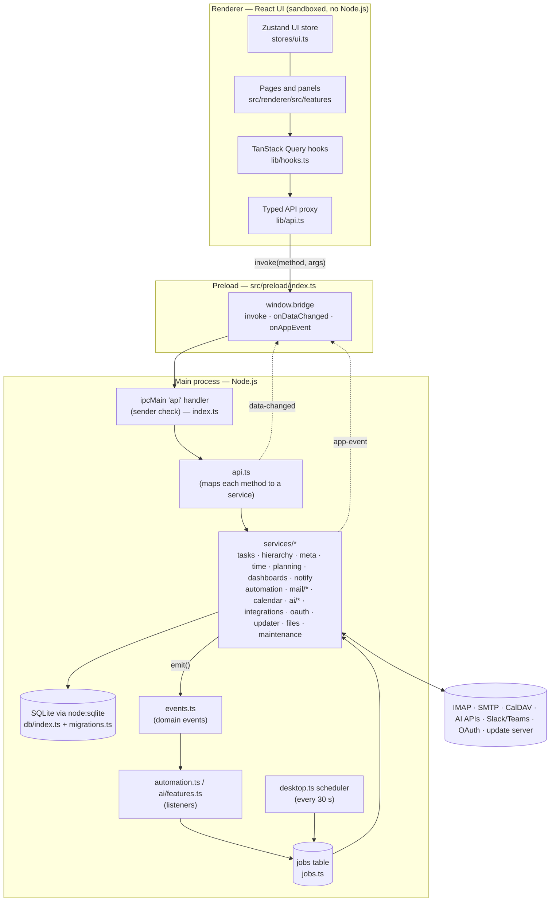

# Architecture

FollowUp is an [Electron](https://www.electronjs.org) app written in TypeScript. It has three layers, each with a clear job and a hard boundary between them.



## The three layers

| Layer | Runs | Can do | Can't do |
|---|---|---|---|
| **Main** (`src/main`) | Node.js in Electron's main process | Database, files, network, secrets, OS integration (tray, notifications, dialogs, login items, updates) | Draw UI |
| **Preload** (`src/preload`) | Before the page loads, in an isolated context | Expose exactly three functions as `window.bridge` | Anything else |
| **Renderer** (`src/renderer`) | Chromium, sandboxed, `contextIsolation: true`, `nodeIntegration: false` | Show UI, call `window.bridge.invoke` | Touch the disk, network, secrets or Node.js APIs |
| **Shared** (`src/shared`) | Imported by all | Types, the API contract, date helpers, the automation catalogue | — (pure code, no side effects) |

## The typed API (IPC)

1. **The contract:** `src/shared/api.ts` defines `interface Api`, every method the window may call, such as `createTask(input: NewTask): Task`.
2. **The renderer** calls `api.createTask({...})`. `src/renderer/src/lib/api.ts` is a `Proxy` that turns any method call into `window.bridge.invoke('createTask', [args])` and shows a toast if it throws.
3. **The preload** forwards it as `ipcRenderer.invoke('api', method, args)`.
4. **The main process** (`src/main/index.ts`) has one handler for the channel `api`. It:
   - **rejects** calls that don't come from the app's own top-level page (`event.senderFrame` must be the main frame and `isAppUrl(frame.url)`), see ADR-002;
   - looks the method up in `src/main/api.ts` (`export const api: Api = {...}`), rejecting unknown names;
   - calls it and returns the result. Exceptions become rejected promises, and their message is shown to the user.
5. **After a mutation:** methods whose names start with `get`, `list`, `query`, `search` or `test` are read-only. After any other call, the main process broadcasts **`data-changed`** to all windows. Async mutations broadcast again when they finish.
6. **In the renderer**, `lib/hooks.ts` listens to `data-changed` and **invalidates the whole TanStack Query cache**. Every visible view refetches. With a local database this is cheap, and it guarantees the UI never shows stale data after a change made anywhere: the UI, automations, sync, AI or the tray.

**Main → renderer events** (`app-event`, type `AppEvent` in `shared/api.ts`):

| Event | Effect in the UI |
|---|---|
| `open-task` | Opens the task panel (notification click, tray) |
| `quick-add` | Opens Quick add (tray) |
| `navigate` | Changes the route (tray → Time tracking) |
| `ai` | Assistant streaming text and changes |
| `update` | Update status changes |
| `compose` | Opens Compose with a draft (the assistant's `draft_email`) |

## Services (main process)

| Module | Responsibility |
|---|---|
| `db/index.ts` | Opens SQLite (WAL, foreign keys, busy timeout), `all/get/run/tx` helpers, `uuid()`, `now()` |
| `db/migrations.ts` | Ordered schema migrations; `PRAGMA user_version` tracks progress |
| `services/hierarchy.ts` | Spaces, folders, lists, statuses (incl. remapping between spaces) |
| `services/tasks.ts` | Tasks: query, create, update, delete, move, duplicate, recurrence, checklists, comments, dependencies, FTS index, activity log, My Work |
| `services/meta.ts` | Tags, custom fields, settings (incl. encrypted secret settings), saved views, search |
| `services/time.ts` | Timer, time entries, CSV |
| `services/planning.ts` | Goals, key results, sprints, burndown |
| `services/dashboards.ts` | Dashboards, widgets, widget data |
| `services/notify.ts` | Reminders, notifications, due and digest checks (`collectDue`) |
| `services/events.ts` | In-process domain events with automation depth |
| `services/jobs.ts` | Persistent job queue with retry and backoff |
| `services/automation.ts` | Rule storage, validation, matching, conditions, actions, time-based triggers, test and run |
| `services/mail/*` | Accounts and sync (`accounts.ts`), parsing, threading and storage (`store.ts`), outbox (`send.ts`), follow-ups (`sequences.ts`), connections (`transport.ts`), secret codec (`secrets.ts`), sync orchestration and email→task (`index.ts`) |
| `services/calendar.ts` | Local and CalDAV calendars, events, recurrence expansion, sync, .ics |
| `services/ai/*` | Providers (`providers.ts`), assistant loop (`assistant.ts`), tools (`tools.ts`), inline features, triage, usage (`features.ts`) |
| `services/integrations.ts` | Slack and Teams posting, Slack channel polling |
| `services/oauth.ts` | Google and Microsoft sign-in (PKCE + loopback), token refresh |
| `services/updater.ts` | electron-updater wrapper |
| `services/files.ts` | Task attachments, untrusted file opening, backups, exports, data folder |
| `services/exporter.ts` | JSON export builder |
| `services/maintenance.ts` | Retention, orphan cleanup, legacy conversions, compaction, backup policy |
| `services/seed.ts` | Example workspace on first run |
| `desktop.ts` | Window, tray, notifications (toasts), scheduler, housekeeping, close-to-tray, app identity |
| `index.ts` | App start-up, single-instance lock, IPC handler |

Services are plain functions over the database helpers. They don't import Electron unless they need the OS, which keeps them unit-testable in plain Node.js. The exceptions are `files.ts`, `updater.ts` and `desktop.ts`.

## Domain events

`services/events.ts` is a tiny synchronous event bus:

```ts
emit({ type: 'task.status_changed', taskId, from, to })   // in tasks.ts, inside tx()
onEvent((e) => { /* automation.ts, ai/features.ts listen */ })
```

| Event | Raised by |
|---|---|
| `task.created` | `createTask` |
| `task.status_changed` | `updateTask` |
| `task.priority_changed` | `updateTask` |
| `task.moved` | `updateTask` (list change) |
| `task.tag_added` | `updateTask` (new tags) |
| `task.comment_added` | `addComment` (carries the author) |
| `task.checklist_completed` | `updateChecklistItem` (last item ticked) |
| `time.logged` | `stopTimer`, `addTimeEntry`, `updateTimeEntry` |
| `mail.received` | `syncMailAccount` (new inbound mail after the first sync) |
| `mail.triaged` | `ai_triage` job |

- **Same transaction:** events are emitted **inside the database transaction** of the change, so whatever a listener writes (usually a queued job) commits or rolls back together with it.
- **Depth:** each event carries a `depth`. `withDepth(n, fn)` sets it while an automation's actions run, and the automation engine stops chains at depth 5.

## The job queue

`services/jobs.ts` stores work in the `jobs` table:

```ts
registerJobHandler('mail_send', async (job) => { … }, onFinalFailure)
enqueue('mail_send', { outboxId }, { maxAttempts: 5, runAt })
```

- **States:** `pending → running → done | failed`.
- **Retry:** on failure, a job goes back to `pending` with `run_at` pushed back by **30 s × 4^(attempt−1)**, capped at 1 hour (30 s, 2 min, 8 min, 32 min, 1 h…). After `max_attempts` it's `failed` and the optional `onFail` handler runs.
- **Recovery:** jobs left `running` by a crash are reset to `pending` at start-up (`recoverJobs`).
- **Pick-up:** `processJobs()` runs every due job in order. New jobs wake it immediately (`setJobWaker`) and the scheduler also calls it every 30 s.

| Job type | Queued by | Attempts | Does |
|---|---|---|---|
| `automation` | Event listener, `automationTick`, *Run now* | 3 (1 for *Run now*) | Run one rule |
| `ai_prompt` | *Ask AI* action | 3 | Ask the AI, add a comment |
| `ai_triage` | `mail.received` (auto sort), *Sort inbox now* | 3 / 2 | Classify a thread, emit `mail.triaged` |
| `account_sync` | Scheduler, *Sync now*, new accounts | 1 | Sync mail or CalDAV |
| `caldav_sync` | Event edits | 5 | Push and pull a CalDAV account |
| `mail_send` | Compose, sequences, automations | 5 | Send one outbox item |
| `mail_flags` | Mark read/unread | 5 | Push `\Seen` flags to IMAP |
| `sequence_step` | `sequenceTick` | 3 | Send or reschedule one follow-up step |
| `integration_post` | Notifications mirror, *Post to Slack/Teams*, Share | 4 | Post to Slack or Teams |
| `slack_poll` | `slackTick` (every 2 min) | 1 | Turn reacted Slack messages into tasks |

## The scheduler and housekeeping

`desktop.ts → startScheduler()` sets up timers after the window opens:

| Every | Work |
|---|---|
| 30 s (`tick`) | 1. `collectDue` (reminders, due notices, daily digest) → toasts and Slack/Teams mirroring<br>2. `automationTick` (due, overdue, schedule, no-reply and event triggers), `sequenceTick`, `slackTick`<br>3. mail sync when `syncIntervalMin` has passed; calendar sync every 15 min<br>4. `processJobs`, refresh tray and title |
| 1 h | `autoBackup` (only if the last backup is over 24 h old) |
| 24 h | `runMaintenance` + `compactDb` |
| 3 s after start | `housekeeping()`: backup (forced before first-time data conversions), maintenance, compaction |

## Start-up sequence

`src/main/index.ts`:

1. Apply `FOLLOWUP_DATA_DIR` if set.
2. `app.requestSingleInstanceLock()`: a second launch tells the first to `showWindow()` and quits.
3. `whenReady`:
   1. set the AppUserModelID (packaged: `app.followup.desktop`; dev: `.dev`, see ADR-009);
   2. remove the app menu;
   3. `openDb` (+ migrations), then `seedIfEmpty`;
   4. `applySettings` (login item, updater feed);
   5. `registerIpc`;
   6. `createWindow`, `createTray`, `startScheduler` (which also wires the DPAPI secret codec, mail data dir, AI emitter, notification delivery, job waker and updater);
   7. `setTimeout(housekeeping, 3000)`.
4. Window close: ask the first time, then follow `closeToTray`. `before-quit` marks quitting so closing doesn't ask again. `will-quit` closes the database.

## Security boundaries

The details are in ADR-001, 002, 004, 008 and 009.

- **Renderer sandbox:** context isolation, no Node.js, CSP in `index.html`.
- **Navigation lock:** `will-navigate`, `will-redirect` and `will-attach-webview` keep the main frame on the app page; `window.open` is denied, and web links open in the browser.
- **IPC sender check** on every call.
- **Secrets:** encrypted via Electron `safeStorage` (DPAPI) through `mail/secrets.ts`, never sent to the renderer.
- **Email HTML:** sanitised on import (`sanitizeHtml`), shown in a sandboxed `srcdoc` iframe with its own CSP (`EmailBody.tsx`).
- **Untrusted files:** Mark of the Web, and a dangerous-extension gate (`openUntrustedFile`).
- **Automated mail:** recognised from headers and never auto-replied to; one send per rule, recipient and day.
- **Outbound connections:** TLS required for remote mail servers; HTTPS required for webhooks and update feeds.

## Renderer structure

```
src/renderer/src/
├── App.tsx              Routes, global shortcuts, app events, error boundaries, toasts
├── main.tsx             React root, QueryClientProvider, HashRouter, file-drop guard
├── lib/                 api proxy, query hooks (+ optimisticPatch), utils (dates, durations, priorities)
├── stores/ui.ts         Zustand: open task, quick add, palette, assistant, compose, toasts
├── components/          ui.tsx (Button, Modal, Popover, …), selects, charts, ErrorBoundary
└── features/
    ├── sidebar/         Tree, space settings (statuses, custom fields)
    ├── home/            My Work
    ├── views/           LocationPage, FilterBar, List/Board/Calendar/Gantt, SprintHeader
    ├── tasks/           TaskPanel, QuickAdd, RichEditor (Tiptap), pickers, TaskSearch
    ├── mail/            InboxPage, EmailBody, Compose, FollowUpsPage
    ├── calendar/        CalendarPage
    ├── automations/     AutomationsPage, AutomationEditor, describe.ts
    ├── ai/              AssistantPanel, TaskAi, MailAi, Markdown, stream
    ├── dashboards/ goals/ time/ notifications/ search/ settings/
```

- **Routes** use a hash router (`#/l/list/<id>`, `#/inbox?thread=…`).
- **Data:** server data lives in **TanStack Query** with `staleTime: Infinity`; it's refetched on `data-changed`. Pure UI state lives in **Zustand**.
- **Errors:** each region (sidebar, page, task panel, assistant, dialogs) is wrapped in an `ErrorBoundary`, so a rendering error never blanks the whole window (ADR-005).

## Conventions

- **Ids:** UUID strings everywhere.
- **Timestamps:**
  - Instants (`created_at`, `sent_at`, time entries) are UTC ISO strings.
  - Calendar-style dates (due dates, events, reminders) are **local** `YYYY-MM-DD` or `YYYY-MM-DDTHH:mm`, validated by `isAppDate`.
  - Date helpers are in `src/shared/dates.ts`.
- **Positions** are REAL numbers, so items can be inserted between others without renumbering.
- **JSON columns** (configs, triggers, conditions, actions, payloads) are stored as text and parsed in the service.
- **Validation lives in services:** never trust the caller, whether it's the UI, AI or an automation. Error messages are written for end users.
