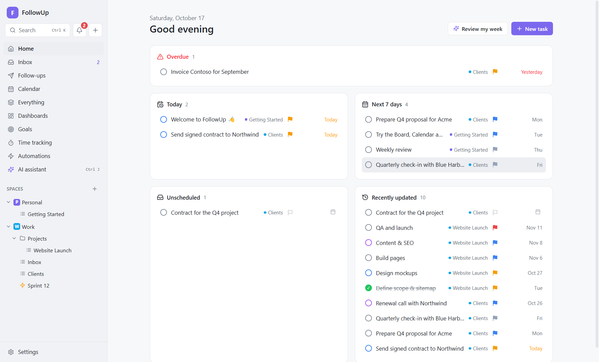

# 1. Getting started

## What FollowUp is for

FollowUp keeps the things you have to do (tasks), the people you're waiting on (email follow-ups) and the time you have (calendar) in one place, on your own PC. It can do routine work for you (automations) and help with reading and writing (AI). Everything works offline; anything online is something you connect yourself.

## Installing

1. Download `FollowUp-Setup-x.y.z.exe` from the project's **Releases** page.
2. Run it. FollowUp installs **for your Windows user only** (default folder `%LOCALAPPDATA%\Programs\FollowUp`). No administrator rights are needed. You can change the folder in the installer.
3. If Windows shows **"Windows protected your PC"**, click **More info → Run anyway**. This happens because the installer isn't code-signed yet; it isn't a virus warning. To be extra careful, compare the file's SHA-256 hash with the one in the release notes (`Get-FileHash .\FollowUp-Setup-x.y.z.exe` in PowerShell).
4. The installer creates **Start menu** and **desktop** shortcuts named *FollowUp*, and can start the app when it finishes.

**Requirements:** Windows 10 or 11 (64-bit), about 400 MB of disk space for the app, plus whatever your data needs.

**Uninstalling:** use **Settings → Apps → FollowUp → Uninstall**. Your data folder (`%APPDATA%\FollowUp`) is **kept**, so reinstalling brings everything back. Delete that folder yourself if you want to remove your data too.

## The first launch

The first time it starts, FollowUp creates a small example workspace so the screens aren't empty:

| Space | Contents |
|---|---|
| **Personal** | List *Getting Started*: <ul><li>"Welcome to FollowUp 👋", due today</li><li>"Try the Board, Calendar and Gantt views", with a checklist and a subtask</li><li>"Weekly review", which repeats every week</li><li>"Install FollowUp", already done</li></ul> |
| **Work** | Folder *Projects* → list *Website Launch*, with five tasks that have start and due dates (they show up nicely on the Gantt chart); list *Inbox*. |

You can rename, reuse or delete all of it. Nothing is created again once a space exists.

## The main window



**Sidebar (left), top to bottom:**

| Element | What it does |
|---|---|
| **Search** (`Ctrl+K`) | Opens the command palette: search tasks (titles and descriptions) and lists, or run commands such as *New task*, *Compose email*, *Toggle dark mode*, *Stop running timer*. |
| **🔔 Notifications** | The notification center: due-date notices, reminders, daily summaries and automation messages, plus a *Reminders* tab to create and manage reminders. The red badge counts unread notifications. |
| **＋** (`Ctrl+N`) | Quick add a task. |
| **Timer bar** | Appears while a timer runs: shows the task and the elapsed time, with a stop button. |
| **Home** | "My Work": overdue, today, the next 7 days, unscheduled and recently updated tasks. |
| **Inbox** | Your email (with the unread count). |
| **Follow-ups** | Follow-up sequences, people in progress and email templates. |
| **Calendar** | Events from all your calendars plus task due dates. |
| **Everything** | Every task from every space in one view. |
| **Dashboards** | Charts and counters. |
| **Goals** | Goals and key results. |
| **Time tracking** | Weekly timesheet and time entries. |
| **Automations** | Your rules, templates and run history. |
| **AI assistant** (`Ctrl+J`) | Opens the assistant side panel. |
| **Spaces** | Your workspace tree. Hover a row and click **⋯** for its menu; click **＋** to add a space. |
| **Restart to update** | Appears when an update has been downloaded. |
| **Settings** | All settings. |

**Main area:** the page you opened.

**Overlays:**
- the **task panel** slides in from the right when you open a task;
- the **assistant** has its own panel;
- dialogs appear in the middle, and short confirmations ("toasts") at the bottom right.

## Closing, quitting and the tray

FollowUp is designed to keep working when you aren't looking at it. Reminders, due-date notifications, email sync, automations and follow-up emails all run in the background. **They only run while FollowUp is running.**

- **The first time you close the window**, FollowUp asks:
  - **Keep running in the background:** the window hides; FollowUp keeps working from the system tray (the icons next to the clock; click **^** if you don't see it).
  - **Quit FollowUp:** the app exits completely.
  - The checkbox **Don't ask me again** remembers your answer. You can change it later in **Settings → Window & startup → Keep running in the system tray when the window is closed**.
- **To reopen** a FollowUp that is running in the background, do any of these:
  - click **FollowUp** in the Start menu or on the desktop (it brings the existing window back; it never starts a second copy);
  - click the **tray icon**;
  - right-click the tray icon → **Open FollowUp**.
- **The tray menu (right-click):**
  - **Open FollowUp** and **New task…**
  - the running timer with **Open timed task** and **Stop timer**
  - **Time tracking**
  - **Restart to update** (when an update is ready)
  - **Quit FollowUp**
- **While a timer runs,** the window title and the tray tooltip show it, e.g. `⏱ 0:42 · Design mockups — FollowUp`.
- **Settings → Window & startup → Start FollowUp when I sign in to Windows** starts it hidden in the tray when you log in, so follow-ups and reminders work even if you never open the window. This only applies to the installed app.

## Keyboard shortcuts

| Keys | Action |
|---|---|
| `Ctrl+K` | Search and command palette |
| `Ctrl+N` | New task (Quick add) |
| `Ctrl+J` | Open / close the AI assistant |
| `Esc` | Close the task panel or the current dialog |
| `Enter` in Quick add | Create the task |
| `Ctrl+Enter` in Quick add | Create the task and open it |
| `Alt+Enter` in Quick add | Let AI fill in the due date, priority and tags from your sentence |
| `Ctrl+Enter` in a comment or email | Send |
| `Enter` in a date field | Save the typed date |

## Where your data lives

Everything is in one folder: **`%APPDATA%\FollowUp`** (paste that into File Explorer's address bar). **Settings → Data & backups → Open folder** opens it.

```
%APPDATA%\FollowUp\
├── followup.db                  The database: all tasks, settings, mail, automations… (SQLite)
├── followup.db-wal / -shm       SQLite's write-ahead log (part of the database; leave them alone)
├── attachments\<task id>\       Files you attached to tasks (copies)
├── mail\<account id>\           Email attachments, one folder per message and attachment
│   └── inline\                  Pictures shown inside emails, stored once per account
└── backups\                     Daily database backups (followup-YYYY-MM-DDTHH-MM-SS.db)
```

- **Passwords, API keys and sign-in tokens** are stored inside the database **encrypted with Windows DPAPI**. Only your Windows user on this PC can decrypt them.
- **Portable or test mode:** start FollowUp with the environment variable `FOLLOWUP_DATA_DIR` set to another folder, and it uses that folder instead.

See [Settings & data](12-settings-and-data.md) for backups, export and moving to another PC.

## Updates

**Settings → Updates** shows your version and the update status. When an update server is configured (built into the installer, or entered in Settings), FollowUp:

- checks for updates 15 seconds after start-up and then every 6 hours;
- downloads updates in the background;
- shows **Restart to update** in the sidebar, the tray and Settings;
- installs the update the next time it quits if you don't click that.

Turn off **Download updates automatically** to only check when you click **Check for updates**. Only `https://` update servers are accepted.

## Behind the scenes: what happens when FollowUp starts

This is the start-up sequence in `src/main/index.ts` and `src/main/desktop.ts`:

1. **One copy only.** FollowUp takes a "single instance" lock. If another copy is already running, the new one tells it to show its window and exits. That's why the Start-menu icon reopens a hidden window.
2. **Windows identity.** It registers its Windows app ID (`app.followup.desktop`), so its taskbar button, pins and notifications are attributed to *FollowUp*.
3. **Database.** It opens `followup.db`, applies any pending migrations (numbered schema upgrades, tracked with SQLite's `user_version`), and creates the example workspace if there are no spaces yet.
4. **Settings.** It applies settings with side effects, such as start-at-login and the update server.
5. **API.** It registers the API that the window uses. Each request is checked to come from FollowUp's own page.
6. **Window, tray and scheduler,** in that order. The window appears within about a second.
7. **Housekeeping,** about 3 seconds later:
   1. the daily backup;
   2. maintenance (clearing old notifications and logs, removing orphaned data, one-time data conversions);
   3. compaction, which gives unused database space back to the disk.

After that, a **scheduler** wakes up every **30 seconds**. Each time it:
- checks reminders and due dates (notifications);
- checks time-based automations (due dates, overdue, schedules, "no reply" and calendar triggers);
- queues follow-up emails that are due;
- polls Slack channels you watch (every 2 minutes);
- syncs email every *N* minutes (your setting) and calendars every 15 minutes;
- runs any background jobs that are due.

It also takes a backup at most once a day, and runs maintenance and compaction daily.

**Connected chapters:**
- [Tasks](03-tasks.md): what you'll do most.
- [Automations](09-automations.md): how background work is triggered.
- [Settings & data](12-settings-and-data.md): every setting.
