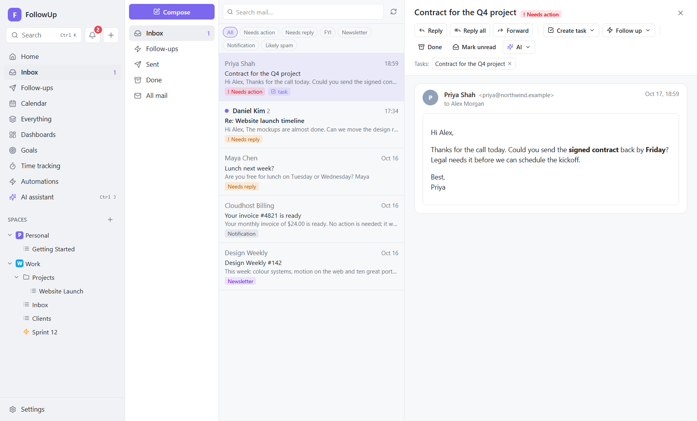

# 6. Email

## What it's for

Most work arrives by email, and much of it stalls waiting for a reply. FollowUp puts your inbox next to your tasks so you can:

- turn an email into a task in one click;
- see a task's email history inside the task;
- start an automatic follow-up when you're waiting on someone;
- let rules and AI sort and act on new mail.

It's a focused email client, not a full replacement for Outlook or Gmail. It syncs your **Inbox** and **Sent** folders, which is where follow-up work happens.

## Connecting an account

Go to **Settings → Accounts**. Pick the option that matches your provider:

| Option | Use it for | What you need |
|---|---|---|
| **Sign in with Google** | Gmail and Google Workspace. Also adds **Google Calendar**. | A Google OAuth client ID (one-time setup, guided below), unless your build includes one. |
| **Sign in with Microsoft** | Outlook.com, Hotmail, Microsoft 365 mail | A Microsoft application (client) ID (one-time setup, guided), unless your build includes one. |
| **Email (app password)** | Any provider over IMAP/SMTP. Presets: Gmail, iCloud Mail, Yahoo Mail, Zoho Mail, Fastmail, Outlook / Microsoft 365, Other. | An **app password** from your provider (the preset tells you where to create one), or your normal password for servers that still allow it. |
| **Calendar (CalDAV)** | Calendars only; see [Calendar](08-calendar.md) | Server URL, username, app password |

### Email with an app password
1. Choose the **Provider**. The server settings fill in, with help text on where to create an app password.
2. Enter your **email address**, **your name** (shown to recipients) and the **app password**.
3. Optional, under the advanced settings:
   - IMAP and SMTP host, port and security (SSL/TLS or STARTTLS);
   - username (defaults to the email address);
   - how much history to import: the last **7, 30 (default), 90 or 365 days**.
4. **Test connection** checks receiving (IMAP) and sending (SMTP) separately and explains any error in plain English.
5. **Add account.** The first sync starts at once.

> **Outlook.com and many Microsoft 365 accounts no longer allow app passwords.** Use *Sign in with Microsoft* instead.
> **Gmail:** app passwords need 2-Step Verification. *Sign in with Google* is easier and adds your calendar.

### Sign in with Google or Microsoft
1. Click the button. If no client ID is set up yet, FollowUp shows a short guide.
   - **Google:**
     1. In console.cloud.google.com, create a project.
     2. Enable the *Gmail API* and the *CalDAV API*.
     3. Set up the *OAuth consent screen* (External; add yourself as a test user).
     4. Create an *OAuth client ID* of type *Desktop app*.
     5. Paste the client ID and client secret.
   - **Microsoft:**
     1. In portal.azure.com → *Microsoft Entra ID* → *App registrations* → *New registration*, choose "any organizational directory and personal Microsoft accounts".
     2. Set the redirect URI to *Public client/native* `http://localhost`.
     3. Paste the application (client) ID.
2. Your **own browser** opens the provider's sign-in page; FollowUp never shows a login window of its own. Approve access.
3. FollowUp adds the mail account (and, for Google, a Google Calendar account) and starts syncing.

When a sign-in expires or is revoked, the account card shows **Sign in again**. Signing in again with the same address updates the existing accounts; it also converts an app-password account to sign-in.

> Google keeps apps in "Testing" mode for personal use. In that mode a sign-in expires after **7 days** unless the app is verified by Google. Use an app password if that's a nuisance.

### The account card
Each account shows its address and when it last synced (or the last error). It also has **Sync now** and **Remove**. Removing an account deletes its synced mail and attachments from FollowUp, but **not** from the server.

## How syncing works

- **What:** the **INBOX** and your **Sent** folder (found by its standard "Sent" flag or common names).
- **First sync:** imports the last *N* days (your choice; at most the 500 newest messages per folder) **quietly**. Old mail doesn't fire automations or stop follow-ups.
- **Afterwards:**
  - FollowUp checks for new mail every **1, 2 (default), 5, 15 or 30 minutes** (**Settings → Email & follow-ups**), and whenever you click ⟳ in the Inbox;
  - only new messages are downloaded;
  - each new incoming message raises an **"email received"** event.
- **Read and unread state** syncs both ways:
  - opening an unread thread marks it read after a moment, here and on the server;
  - **Mark unread** reverses it;
  - mail read on your phone shows as read here at the next sync.
- **Threads:** messages are grouped by the standard reply headers (`Message-ID`, `In-Reply-To`, `References`). When those are missing, a reply ("Re: …") joins a recent thread with the same subject and a shared participant.
- **Robustness:** a message that can't be read is skipped and counted on the account card ("Skipped 1 message…"); it stays on the server. It never blocks the rest of the mailbox.

## Reading mail

- **Folders:**
  - **Inbox** (not Done);
  - **Follow-ups** (threads with an active sequence);
  - **Sent**, **Done** and **All mail**;
  - an account filter appears when you have several accounts.
- **Search** looks through subjects, senders and message text.
- **Thread list:**
  - an unread dot, people, message count, 📎 for attachments, date, subject and preview;
  - chips for the AI category, an active follow-up ("Polite nudge · 1/2") and a linked task.
- **AI categories:** with AI triage, chips at the top filter by category (*Needs action, Needs reply, FYI, Newsletter, Notification, Likely spam*). See [AI](10-ai.md#inbox-triage).
- **Messages:**
  - The last message and any unread ones are expanded; click a header to expand others.
  - Your own messages have an accent border.

### Reading safely
Email is the most common way attacks arrive, so FollowUp is strict:

- **Scripts, forms, embedded frames and event handlers are removed**, and the message is shown in a **sandboxed** frame that can't run code or navigate.
- **Remote images are blocked** by default, because they can tell the sender that (and when) you opened the email. Click **Show images** for one message, or turn on **Settings → Email & follow-ups → Load remote images**.
- **Links** open in your normal browser.
- **Pictures inside emails** (logos, signatures) are stored once per account as files, and shown from your disk.
- **Attachments:**
  - Click to open; files are saved with Windows' "downloaded from the internet" mark (Mark of the Web), so Windows and Office apply their usual protections.
  - **Programs, scripts, shortcuts, installers and disk images** (`.exe`, `.js`, `.lnk`, `.msi`, `.iso`, …) are **never opened** by FollowUp. You get a warning and **Show in folder** instead.
  - Attachments over 10 MB are listed but not saved by FollowUp; open those in your usual email app.

## Acting on a thread

| Button | What happens |
|---|---|
| **Reply / Reply all** | Opens Compose with the right recipients (yourself excluded), "Re:" subject and the last incoming message quoted. The reply is threaded correctly. |
| **Forward** | Opens Compose with the message text and its headers. |
| **Create task ▾** | Pick a list. Creates a task: title = subject without "Re:/Fwd:", description = sender and latest message. Task and thread are **linked**: the thread shows "Tasks: …" and the task shows the email. |
| **Follow up ▾** | Start a follow-up sequence on this thread. See [Follow-ups](07-follow-ups.md). |
| **Done** | Moves the thread out of the Inbox **in FollowUp only** (the server isn't changed). A new incoming message brings it back. |
| **Mark unread** | Marks it unread here and on the server. |
| **✨ AI** | Summarize, draft a reply, find tasks, sort this email. See [AI](10-ai.md). |

## Writing and sending

- **Compose:** the **Compose** button in the Inbox, `Ctrl+K → Compose email`, **Email** in a task, the AI assistant's drafts, or Reply/Forward.
- **Fields:**
  - **From:** choose an account.
  - **To / Cc:** addresses separated by commas; `Name <address>` works.
  - **Subject** and **Message:** plain text.
- **Formatting:** paragraphs and line breaks are kept, lines starting with `>` are shown as a quote, and links become clickable.
- **Templates:** **Insert template…** inserts a saved email template (manage them under **Follow-ups → Email templates**).
- **Sending:** `Ctrl+Enter` or **Send**. Closing a draft you've written in asks before discarding it.
- **What happens after you press Send:**
  1. The email goes into an **outbox** and a background job sends it (up to 5 attempts, waiting 30 seconds, 2 minutes, 8 minutes and 32 minutes in between). While it's retrying, the thread shows *"Sending… (retrying: reason)"* with **Cancel**; if it finally fails, *"Couldn't send"* with **Retry**.
  2. As soon as the server accepts it, it's recorded as **sent**, so it can never be sent twice, even if a later step fails.
  3. A copy goes to your server's Sent folder when the provider doesn't do that itself (Gmail and Exchange do).
  4. It appears in the thread right away.
- **Replying yourself stops that thread's follow-up sequence**, because a human is now in charge.

## Behind the scenes

- **Code:**
  - `src/main/services/mail/`: `accounts.ts` (accounts, sign-in, sync), `store.ts` (parsing, threading, storage, attachments, sanitising), `send.ts` (outbox and sending), `sequences.ts` (follow-ups), `transport.ts` (IMAP/SMTP connections and readable errors);
  - `src/main/services/oauth.ts` (Google/Microsoft sign-in);
  - UI in `src/renderer/src/features/mail/`.
- **Connections:** IMAP is handled by *imapflow*, SMTP by *Nodemailer*, and parsing by *mailparser*.
  - Remote servers always use TLS: implicit TLS (ports 993/465), or STARTTLS, which is required on 143/587.
  - Sign-in accounts authenticate with OAuth access tokens (XOAUTH2).
- **Storage:**
  - Messages go in `mail_messages`: sanitised HTML and plain text.
  - Threads go in `mail_threads`, with the *done* flag and the AI category.
  - Attachments are files under `mail\<account>\…` (`mail_attachments`).
  - Search uses the `mail_fts` full-text index.
- **Secrets:**
  - Passwords and refresh tokens are encrypted with Windows DPAPI.
  - Access tokens are kept only in memory and refreshed when needed.
  - The window never receives any secret.
- **Background jobs:**
  - `account_sync`: a sync;
  - `mail_send`: sending, 5 attempts;
  - `mail_flags`: pushing read/unread to the server.
- **After each newly synced incoming message** (in the same transaction):
  - follow-up **reply detection** runs; it stops the thread's sequence, or marks it *bounced* for delivery failures;
  - a **`mail.received`** event is raised for automations and AI triage.
- **Automated mail** (auto-replies, mailing lists, newsletters, bounces and `no-reply` senders, recognised from standard headers) is flagged. Automation rules never auto-reply to such mail.

## How it connects

| Feature | Connection |
|---|---|
| [Tasks](03-tasks.md) | Create task from email; linked emails in the task panel; "Email" from a task |
| [Follow-ups](07-follow-ups.md) | Sequences reply in threads; stop on reply, bounce or your reply |
| [Automations](09-automations.md) | Triggers *email arrives*, *sent email gets no reply*, *AI classifies an email*; email conditions; actions *send email*, *reply*, *create task from email*, *start sequence*, *mark read* |
| [AI](10-ai.md) | Triage, summaries, reply drafts, extracting to-dos; the assistant can search and read threads and open drafts |
| [Calendar](08-calendar.md) | *Sign in with Google* also adds Google Calendar |

## Examples

- **Client asks for something:** open the email → **Create task ▾ → Clients**, set a due date in the panel, then reply *"On it — you'll have it Friday."* The task links to the thread for context.
- **Proposal sent, waiting for an answer:** open your sent email → **Follow up ▾ → Polite nudge**. If they reply, the follow-up stops by itself.
- **Inbox zero:** reply or create tasks for what matters, then press **Done** on each thread. The Inbox only shows what still needs you.
