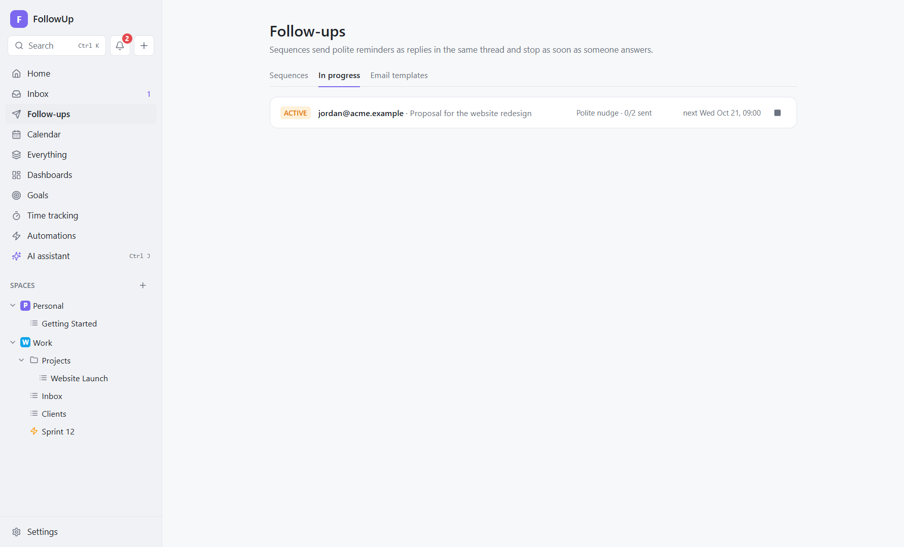

# 7. Follow-up sequences

## What they're for

You sent a proposal, an invoice or a question, and nothing came back. A **follow-up sequence** remembers for you and sends polite reminders in the same email thread on a schedule you set. It **stops by itself the moment the other person replies**, so you never nag someone who already answered.

Typical uses:
- sales and proposals;
- unpaid invoices;
- job applications;
- getting a decision or a document from someone.

## Key ideas

| Term | Meaning |
|---|---|
| **Sequence** | A reusable plan: a list of **steps**, each "wait *N* days, then send this message". Plus a **send window** (days and hours) and a **daily cap**. |
| **Enrollment** | One email thread going through a sequence. Statuses: *active*, *replied*, *completed*, *stopped*, *bounced*, *failed*. |
| **Step message** | Sent as a **reply in the same thread** (subject "Re: …"), with your text. Variables: `{{first_name}}`, `{{name}}`, `{{subject}}`. |

## How to use it

### 1. Create a sequence
**Follow-ups → Sequences → New sequence**. A new sequence starts from a sensible default you can edit:

- **Name**, e.g. *Proposal follow-up*.
- **Steps:** for each step:
  - **Days to wait** after the previous email (fractions work: `0.5` = 12 hours);
  - the **message**.

  The default is two steps: after 3 days *"Just bumping this up…"* and after 4 more days *"Following up one last time on '{{subject}}'…"*. Add steps with **＋**.
- **Only send on:** days of the week (default Mon–Fri) and hours (default 09:00–17:00).
- **Daily cap:** the maximum number of follow-ups this sequence sends per day (default 30). Keeps you from looking like a bulk mailer.

**Save sequence.** Editing a sequence later affects people already in it from their next step. If you remove steps, enrollments that are past the new last step are marked *completed*.

### 2. Start following up
- **From the Inbox:** open the thread (usually your sent email) → **Follow up ▾** → choose a sequence.
- **From the AI assistant:** *"start the Polite nudge follow-up on my proposal to Jordan"*. You approve it first.
- **From an automation:** action **Start a follow-up sequence**, typically with the trigger **A sent email gets no reply** (after N days) or **An email arrives**.

**Who receives it:** the recipients of **your last email** in the thread. If you haven't written in the thread, it goes to the person who last wrote to you.

A thread can only have **one active follow-up**; starting a new one stops the old one ("Replaced by a new follow-up").

### 3. Watch it
- **Inbox:** the thread shows a chip such as *"Polite nudge · 1/2"*, and the thread view has a bar: *"Follow-up Polite nudge · step 1/2 · next email Wed Oct 21, 09:00"*, with **Stop**.
- **Inbox → Follow-ups folder:** every thread with an active sequence.
- **Follow-ups → In progress:** everyone being followed up, with their status, step, next send time (or why it stopped) and a stop button.

### 4. It stops when…

| Event | Enrollment becomes |
|---|---|
| **Anyone replies** in the thread (an incoming message) | *replied* ("ana@client.com replied") |
| The email **bounces** (from mailer-daemon/postmaster, or a subject like "Undeliverable" / "Delivery Status Notification") | *bounced* |
| **You reply yourself** from FollowUp | *stopped* ("You replied") |
| You press **Stop** | *stopped* |
| The last step has been sent | *completed* |
| Sending fails after all retries | *failed* (with the reason) |

## Email templates

**Follow-ups → Email templates** holds reusable emails (name, optional subject, body). Use them in **Compose → Insert template…**; when the subject field is empty, the template's subject is used too. Templates are for emails you write yourself. Sequence steps have their own text.

## Behind the scenes

- **Code:** `src/main/services/mail/sequences.ts`; sending via `src/main/services/mail/send.ts`.
- **Scheduling:**
  - When you enroll a thread, the first send time = now + step 1's wait, moved forward into the send window if needed (`nextWindowStart`).
  - After each send, the next step is scheduled from that moment + its wait, again moved into the window.
- **The tick:** every 30 seconds, `sequenceTick` finds active enrollments that are due. It marks each one "in flight" so it's never queued twice, and queues a `sequence_step` job (3 attempts). The job (`runSequenceStep`) then:
  1. **Safety net:** checks for any incoming message since enrollment. If there is one, it stops (*replied*, or *bounced*) instead of sending.
  2. **Missed while the PC was off:** if the step is more than 24 hours late, it follows **Settings → Email & follow-ups → Follow-ups that came due while this PC was off**: *Send them* (default) or *Skip them*. Skipping moves on to the next step without sending.
  3. **Send window:** outside the window, it reschedules to the next window start.
  4. **Daily cap:** if this sequence already queued its cap today, it reschedules to tomorrow's window.
  5. Otherwise it **queues the reply**, threaded under the latest message, with the "Re:" subject and personalised text. Then it schedules the next step, or marks the enrollment *completed*.
- **Personalisation:**
  - `{{name}}` is the recipient's display name. If the address has no name, FollowUp looks for a name from earlier mail from that address, or turns `jordan.lee@…` into "jordan lee".
  - `{{first_name}}` is the first word, capitalised; "there" is used when nothing is known.
  - `{{subject}}` is the thread's original subject.
- **Reply detection** happens during mail sync: when a new incoming message is stored, `onInboundReply` stops the thread's active enrollment in the same transaction.
- **Sending:**
  - Follow-up emails use the normal outbox (5 attempts). If an email finally fails, its enrollment becomes *failed* with the error.
  - Follow-ups only go out **while FollowUp is running**. Keep it in the tray, and consider *Start FollowUp when I sign in to Windows*.

## How it connects

| Feature | Connection |
|---|---|
| [Email](06-email.md) | Runs on synced threads; replies stop it |
| [Automations](09-automations.md) | **Start a follow-up sequence** action; the **A sent email gets no reply** trigger (which skips threads that already have an active follow-up) |
| [AI assistant](10-ai.md) | Tools `list_follow_up_sequences` and `start_follow_up` (with approval) |

## Examples

- **Proposal nudge:**
  - Steps: 3 days *"Hi {{first_name}}, any thoughts on the proposal?"*; 5 days *"Should I check back next month instead?"*.
  - Window: weekdays 09:00–17:00.
  - Started from the sent proposal.
- **Invoice reminder:** 7 days *"A friendly reminder that invoice for {{subject}} is due"*; 7 days *"Second reminder…"*; 14 days *"Final reminder…"*. Daily cap 20.
- **Hands-free:** an automation **"A sent email gets no reply in 3 days" → Start "Proposal nudge"** follows up on every unanswered email you send, without you clicking anything. (Narrow it with conditions such as *subject contains "proposal"*.)
