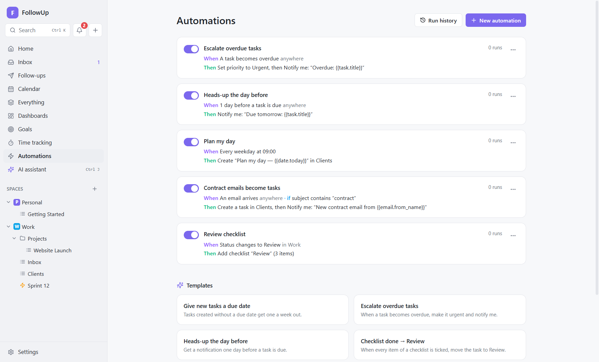
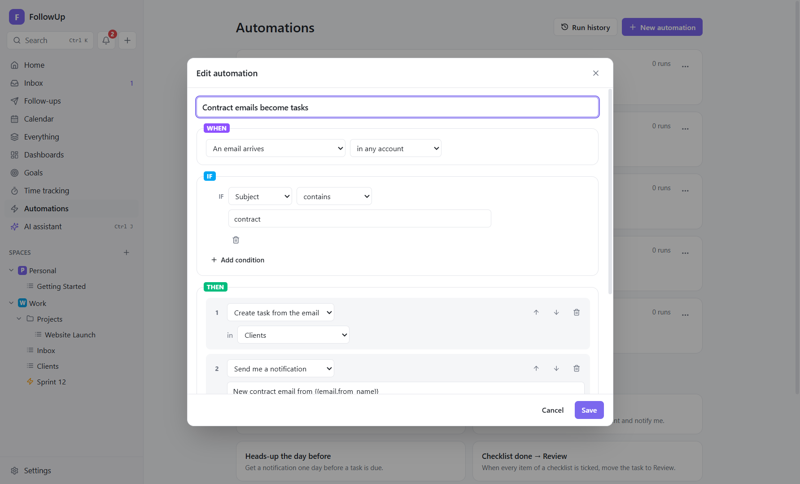
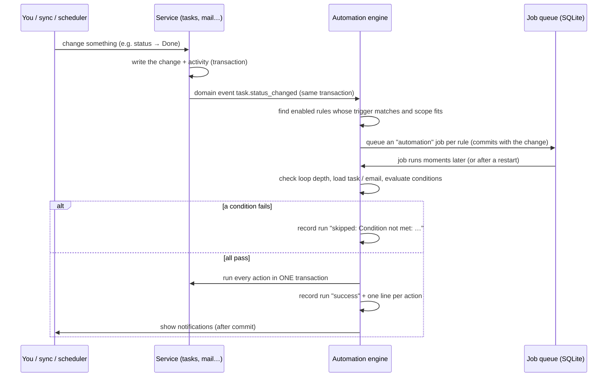

# 9. Automations

## What they're for

Automations do routine work for you, reliably and in the background:

- giving new tasks a due date;
- escalating overdue work;
- turning certain emails into tasks;
- following up on unanswered emails;
- creating your daily planning task;
- posting to Slack when something is done;
- … and anything else you can describe as **"when this happens, if that's true, do this."**

## The model: WHEN → IF → THEN

Every automation (also called a **rule**) has:

| Part | Meaning | Required |
|---|---|---|
| **Name** | For you, e.g. *Escalate overdue tasks* | yes |
| **WHEN: trigger** | The one event that starts the rule | yes (exactly one) |
| **for tasks: scope** | *(task triggers only)* Limit to a space, folder, list or sprint; default *anywhere* | no |
| **IF: conditions** | Checks that must **all** pass (AND). None = always run. | no |
| **THEN: actions** | One or more steps, run **in order** | at least one |
| **On/off switch** | Disabled rules never run (except *Run now*) | — |

The editor only offers conditions, actions and variables that make sense for the chosen trigger. For example, *Reply to the email* isn't offered for a task trigger, and task conditions aren't offered for an email trigger.

## Triggers (WHEN)

Each trigger has a **context**: what the rule's actions can work on.
- **task:** the rule runs on one task.
- **email:** the rule runs on one email (the newest incoming message of the thread, or your sent message for *no reply* and for *waiting on them*).
- **none:** neither (time or calendar based).

### When something changes (context: task)

| Trigger | Fires when | Options |
|---|---|---|
| **A task is created** | Any task or subtask is created: by you, Quick add, email, Slack, AI, recurrence or another automation | — |
| **Status changes** | A task's status changes | *from* and *to* a status **name** (or "any status"). Names match across spaces, case-insensitively. |
| **Priority changes** | The priority changes | *to* a priority, or any |
| **A task is moved to a list** | A task moves to another list | *to* a specific list, or any |
| **A tag is added** | A tag is added to a task | a specific tag, or any |
| **A comment is added** | You or the AI add a comment. **Comments written by automations never trigger this**, which prevents loops. | — |
| **A checklist is completed** | The last unticked item of any checklist on the task is ticked | — |
| **Tracked time exceeds the estimate** | Time logged on a task goes over its estimate | Fires **once per task per estimate value**; raising the estimate re-arms it |

### Time based

| Trigger | Context | Fires | Options |
|---|---|---|---|
| **Due date arrives** | task | For open tasks with a due date. **Date only:** on the day (or *N* days before), from the first check that day. **With a time:** at that moment (or *N* days before), and only within the 12 hours after it. | on the due date/time, or 1, 2, 3 or 7 days before |
| **A task becomes overdue** | task | Once, when an open task passes its due date: the next day for date-only tasks, after the time for timed ones | — |
| **On a schedule** | none | Every day, every weekday (Mon–Fri), every week on a day, or every month on a day (31 becomes the month's last day), **at a time** | frequency, day, time |

### Email and calendar

| Trigger | Context | Fires | Options |
|---|---|---|---|
| **An email arrives** | email | For each **new incoming** message found by a sync (not during an account's first sync) | in any account, or a specific one |
| **An email needs follow-up** | email | A conversation enters [Follow-up](07-follow-ups.md): someone has waited too long for your reply, or your email got no answer (waiting times and working days from Settings → Follow-up). Fires once per waiting email; conversations that were already waiting when you made the rule don't fire. | either way, *they're waiting for my reply*, or *I'm waiting for their answer* |
| **A sent email gets no reply** | email | Your latest message in a thread is older than *N* days and nobody has written since. Fires once per sent message. | within 1, 2, 3, 5, 7 or 14 days |
| **A calendar event is about to start** | none | *N* minutes before a timed event in any enabled calendar | 5, 10, 15, 30 or 60 minutes before |
| **AI classifies a new email** | email | After AI triage sorts a new email (needs **Settings → AI → Sort new email automatically**) | any category, or Needs action / Needs reply / FYI / Newsletter / Notification / Likely spam |

## Scope ("for tasks")

For task triggers, **for tasks** limits the rule to tasks inside one **space, folder, list or sprint**. A rule scoped to space *Work* ignores everything in *Personal*.

## Conditions (IF)

All conditions must pass. Text comparisons ignore upper and lower case.

### For task triggers

| Field | Operators | Notes |
|---|---|---|
| **Status** | is / is not | Compared by status name |
| **Priority** | is / is not | |
| **List** | is / is not | |
| **Tag** | has / does not have | |
| **Title** | contains / does not contain / is | |
| **Due date** | is set / is not set | |
| **Sprint** | is set / is not set | Is the task in any sprint? |
| **Custom field** | is / is not / contains / is greater than / is less than / is set / is not set | Dropdown and label fields compare the option; for labels, *is* means "includes". Numbers compare numerically; text and dates compare alphabetically, so `2026-11-01` > `2026-10-31` works. |

### For email triggers

| Field | Operators | Compares with |
|---|---|---|
| **Sender** | contains / does not contain / is exactly / is not | *contains* checks the name **and** address, so `@acme.com` matches everyone at Acme. *is exactly* checks the address only. |
| **Recipients** | same | All *To* addresses |
| **Subject** | same | Subject line |
| **Message text** | same | Plain-text body |

Schedule and calendar triggers have no conditions.

## Actions (THEN)

| Action | Needs | What it does |
|---|---|---|
| **Change status** | task | Sets the status with that **name** in the task's own space (fails with a clear error if the space has none). |
| **Change priority** | task | Sets the priority. |
| **Set due date** | task | Today, in 1/2/3/7/14/30 days, or clears it. |
| **Add tag / Remove tag** | task | — |
| **Move to list** | task | Moves the task (and its subtasks). |
| **Add comment** | task | A comment by *automation*, with variables. |
| **Create subtask** | task | A subtask with the given title (variables allowed). |
| **Add checklist** | task | A named checklist with items (one per line). |
| **Create reminder** | task | A reminder 15 minutes to 1 week from now, linked to the task. |
| **Set custom field** | task | Sets a field (option, checked state, number or text). |
| **Ask AI (answer as comment)** | task | Sends your prompt plus the task's details (description, subtasks, checklists, recent comments, linked emails) to your AI provider. The answer is added as a comment by *ai*. Runs as its own background job (3 attempts), so a slow or failing AI call doesn't block the rule. |
| **Create task from the email** | email | Like the Inbox button: subject → title, message → description, linked to the thread. |
| **Reply to the email** | email | Queues a reply to the sender, in the thread ("Re: …"), with variables. |
| **Mark the email as read** | email | Here and on the server. |
| **Create task** | any | A new task in a chosen list with title (variables), due date (none, today, in 1/2/3/7 days) and priority. |
| **Send me a notification** | any | An in-app and Windows notification, also mirrored to Slack or Teams if you set that up. |
| **Send an email** | any | Queues an email (to, subject, message; variables allowed). Sends from the email's own account for email triggers, otherwise from your first account. |
| **Post to Slack / Teams** | any | Posts a message to a connected channel. |

## Variables

Type them, or click the chips under any text box. They're replaced when the rule runs.

| Context | Variables |
|---|---|
| task | `{{task.title}}` `{{task.status}}` `{{task.priority}}` `{{task.due_date}}` `{{task.list}}` `{{date.today}}` |
| email | `{{email.from}}` (address) `{{email.from_name}}` `{{email.to}}` `{{email.subject}}` `{{email.snippet}}` (first lines) `{{date.today}}` |
| none (schedule, calendar) | `{{event.title}}` `{{event.start}}` (calendar trigger) `{{date.today}}` |

`{{date.today}}` is the current date as `YYYY-MM-DD`. An unknown variable is left as written.

## Testing, running and history

- **Test** (in the editor) checks the rule **without changing anything**. Pick a task (task rules) or an email (email rules), then **Run test**. You see each check (*in scope*, each condition, *actions ready*) with ✓/✗ and *"This automation would / would not run."*
- **Run now for real** (saved rules) queues the saved rule immediately for the chosen task or email. Schedule and calendar rules need no target; the **⋯ → Run now** menu item on the Automations page does the same for schedule rules.
- **Run history** (per rule via **⋯**, or **Run history** at the top for all rules) shows the last 100 runs per rule:
  - **✓ success:** each action's result, e.g. "Set priority to urgent", "Queued email to ana@…";
  - **– skipped:** which condition failed, or loop protection;
  - **✗ failed:** the error after all retries.
- The Automations list shows each rule in plain English with its run count and last run. **⋯** also offers **Duplicate** (the copy starts disabled) and **Delete**.

## Templates

The Automations page offers ready-made rules to adjust and save:

| Template | Rule |
|---|---|
| Give new tasks a due date | Task created, if no due date → due in 7 days |
| Escalate overdue tasks | Overdue → priority urgent + notify |
| Heads-up the day before | 1 day before due → notify |
| Checklist done → Review | Checklist completed → status *Review* |
| Review checklist | Status changes to *Review* → add a 3-item review checklist |
| Plan my day | Weekdays 09:00 → create "Plan my day — {{date.today}}", due today |
| Weekly review | Fridays 16:00 → create "Weekly review" |
| Over the estimate | Time over estimate → priority high + notify |

## Behind the scenes: how a rule runs

- **Code:** `src/main/services/automation.ts` (matching, conditions, actions, time-based triggers), `src/main/services/events.ts` (domain events), `src/main/services/jobs.ts` (queue), `src/shared/automation.ts` (types and the trigger/action catalogue). Editor: `src/renderer/src/features/automations/`.
- **Events are raised inside the same database transaction as the change.** The queued job is committed together with the change, or not at all, so no event is lost and no ghost rule runs for a change that was rolled back.
- **Jobs survive restarts.** If FollowUp closes before a job runs, it runs on the next start.
  - A failing job gets **3 attempts** in total, waiting 30 seconds and then 2 minutes between them. After the last failure the run is recorded as **failed**.
  - *Run now* runs once.
- **All actions of a run are one transaction.** If action 3 fails, actions 1–2 are undone too and the whole run is retried. Between actions, the task is reloaded, so later actions see earlier changes.
- **Conditions are evaluated when the job runs** (moments after the trigger), against the current state of the task or email.
- **Time-based triggers** are checked by the scheduler every **30 seconds** (`automationTick`). Each firing is recorded once in `automation_fired` with a key:

  | Key | Effect |
  |---|---|
  | `<rule>:due:<task>:<due date>` | Changing the due date re-arms the trigger |
  | `<rule>:overdue:<task>:<due date>` | |
  | `<rule>:schedule:<date>` | One firing per day |
  | `<rule>:noreply:<message>` | |
  | `<rule>:event:<occurrence>` | |
  | `<rule>:overestimate:<task>:<estimate>` | |

  So a rule never fires twice for the same thing, even across restarts. A **schedule** never fires for a time that passed before the rule was created. If the PC was off at the scheduled time, it fires once when FollowUp starts later **that same day**.
- **Loop protection:**
  - Every event carries a **depth**: 0 when you caused it, +1 for each automation in the chain. At depth **5** the chain stops with a *skipped* run: "Stopped: 5 automations already ran in a chain (loop protection)".
  - Comments written by automations don't trigger comment rules.
- **Email loop protection:** when an email-triggered rule sends or replies, FollowUp first checks that the email isn't **automated**: auto-replies (`Auto-Submitted`), mailing lists (`List-*`, `Precedence: bulk/list`), bounces and `no-reply` senders. It also sends **at most one email per rule, per recipient, per day**. Otherwise two auto-responders could email each other forever. Skips appear in the run history.

## Limits and workarounds

| Limit | Workaround |
|---|---|
| Conditions are AND only | For *OR*, make two rules (use **Duplicate**). |
| One trigger per rule | Duplicate the rule and change the trigger. |
| No "else" branch | Make a second rule with the opposite condition. |
| Email triggers can only test email fields | Create the task in one rule; react to *task created* (scoped to that list) in a second rule. |
| Actions run in order, all or nothing | Put risky actions (sending email) last, or in their own rule. |
| Runs only while FollowUp is running | Keep it in the tray and turn on *Start FollowUp when I sign in to Windows*. |

## Recipes

1. **Client emails become tasks**
   - WHEN *An email arrives* · IF *Sender contains `@acme.com`*
   - THEN *Create task from the email* (list *Clients*) · *Send me a notification "New Acme request: {{email.subject}}"*
2. **Unanswered proposals become tasks**
   - WHEN *An email needs follow-up* (*I'm waiting for their answer*) · IF *Subject contains `proposal`*
   - THEN *Create task from the email* (list *Sales*) · *Send me a notification "No answer yet: {{email.subject}}"*
3. **Out-of-office auto-reply (once per sender per day, never to robots)**
   - WHEN *An email arrives* · THEN *Reply to the email "Thanks {{email.from_name}}, I'm away until Monday and will reply then."*
   - Turn the rule on and off with its switch.
4. **AI sorts, rules act**
   - WHEN *AI classifies a new email as "Needs reply"*
   - THEN *Create task from the email* (list *Inbox*) · *Send me a notification "Reply needed: {{email.subject}}"*
5. **Done means announced**
   - WHEN *Status changes to Done* (for tasks in *Website Launch*)
   - THEN *Post to Slack "✅ {{task.title}} is done"* · *Add comment "Completed on {{date.today}}"*
6. **QA gate**
   - WHEN *Status changes to Review* (for tasks in space *Product*)
   - THEN *Add checklist "QA"* (Tested on Windows 10 / Tested on Windows 11 / Release notes) · *Set due date in 2 days*
7. **Bug intake**
   - WHEN *A task is created* (for tasks in list *Bugs*) · IF *Due date is not set*
   - THEN *Set due date in 3 days* · *Change priority High* · *Add tag "bug"*
8. **Meeting heads-up**
   - WHEN *A calendar event is about to start, 10 minutes before*
   - THEN *Send me a notification "Up next: {{event.title}}"* · *Post to Teams "Starting soon: {{event.title}} at {{event.start}}"*
9. **Monday planning**
   - WHEN *On a schedule: every week on Monday at 08:30*
   - THEN *Create task "Plan the week — {{date.today}}"* in *Personal*, due today, priority High
10. **Over budget**
    - WHEN *Tracked time exceeds the estimate*
    - THEN *Change priority High* · *Ask AI "The task went over its estimate. Suggest how to finish it faster."*
11. **Escalate stale "urgent" work**
    - WHEN *Due date arrives, 1 day before* · IF *Priority is Urgent*
    - THEN *Send me a notification "Tomorrow: {{task.title}}"* · *Send an email* to yourself with the same text
12. **Tag-driven workflow**
    - WHEN *A tag is added: "waiting"*
    - THEN *Change status "Blocked"* (needs a *Blocked* status in the space) · *Create reminder in 2 days*

## How it connects

Automations are the glue between the other features:
- they react to **tasks**, **time**, **email**, **AI triage** and **calendar** events;
- they act on **tasks**, **notifications**, **email**, **Slack/Teams** and the **AI**.

> **Coming from 1.0?** The action *Start a follow-up sequence* was removed in 1.1, together with sequences. Rules that used it were switched off at the update and say so in the editor: remove that action and switch the rule on again, or use the [Follow-up](07-follow-ups.md) view.

To add your own triggers or actions in code, see [Customizing → automation triggers and actions](../developer/customizing.md#add-an-automation-trigger).
