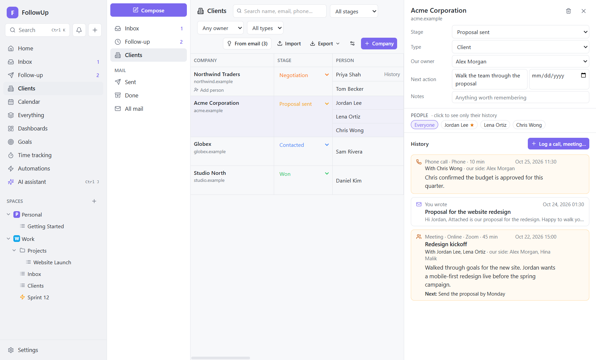

# 15. Clients

## What it's for

Clients keeps everything about the companies you work with in one table, like a spreadsheet:

- their **people** (name, designation, phone, work email);
- **who answers** your emails, and **who acts** on their side;
- **who owns** the relationship on your side, and the **next action**;
- the **stage** of the relationship, from first contact to won or lost;
- the **complete history**: every email, plus every call, WhatsApp chat, meeting (in person, at their office or online) and exhibition, with exactly **which of their people** took part.

Open it from **Clients** in the sidebar or in the Inbox's folder list.

## The table

| Column | Meaning |
|---|---|
| **Company** | One cell for the company, spanning all its people. Its email domains are shown under the name. Hover to see **Add person**. |
| **Stage** | Where the relationship stands (coloured). Change it right in the cell. |
| **Person**, **Designation**, **Phone**, **Work email** | Click a cell and type; **Enter** or clicking away saves, **Esc** cancels. |
| **Last contact** | The latest email from or to them, or logged call, chat or meeting with them. |
| **Responds** | *Yes* when they wrote to you in the last 90 days; *Not lately* when they did before; *—* when never. |
| **Acts for them** | Tick the person responsible for taking action on their side (shown with ★). |
| **Our owner** | Who on your team looks after them (the company's owner unless set per person). |
| **Next action**, **Due** | What happens next and by when (overdue dates turn red). The company's next action shows until a person has their own. |

- **Filters** at the top: stage, owner, type (client, vendor, partner, other), and a search over names, emails, designations and phone numbers.
- **Resize** any column by dragging the edge of its header. Double-click the edge to reset it. Widths are remembered.

## How to use it

### Add clients
- **+ Company:** type the name; then **Add person** in the company cell (hover).
- **From email:** FollowUp lists people you've emailed in the last 6 months who aren't clients yet, grouped by company (everyone `@acme.com` together).
  - Public addresses (Gmail, Outlook…) stay separate.
  - Newsletters, robots and your own company are left out.
  - Choose a new company name (suggested from the domain, e.g. `acme-corp.co.uk` → *Acme Corp*) or an existing company, untick anyone you don't want, and click **Add**.
  - **Ignore** hides that group for good.
- **Import:** choose an Excel (.xlsx) or CSV file whose first row has column names. FollowUp guesses which column is the company, name, designation, phone, email, stage, website or notes; check the guess and the preview, then **Import**.
  - Rows with the same company name end up under one company.
  - People already in Clients (same email) are **updated**, never duplicated.

### Open a company
Click the company name (or **History** next to a person). The panel on the right shows:
- name and email domains (click to edit), stage, type, our owner, next action and due date, notes;
- **People:** click one to see only their history, or **Everyone**;
- **History:** emails (click one to open it in the Inbox) and logged contact, newest first.

### Log a call, chat, meeting or event
**Log a call, meeting…** in the panel:
1. Choose **Phone call**, **Chat / WhatsApp**, **Meeting**, **Exhibition / event** or **Note**.
2. For a meeting, choose where: **In person**, **At their office** or **Online**. Add the place or meeting link.
3. When, title, channel (WhatsApp, Zoom…), minutes.
4. Tick **their people who took part**. Only those people's histories show it. If 2 of their 5 people joined the meeting, only those 2 are recorded.
5. Tick **your team** members who took part.
6. What was discussed or agreed, and the next steps.
7. Optional: **Create a task for the next step** in a list, with a due date.

Edit or delete an entry with the ✎ / 🗑 buttons on hover.

### Stages and team
The ⚙ button opens **Stages and team**:
- **Stages:** rename, recolour, reorder, add (e.g. "Met at exhibition"), remove. Each stage has a kind: in progress, won, lost, on hold.
- **Team:** the people on your side who can own clients and attend meetings. You're added automatically.

### Export
**Export → Excel** saves two sheets: *Clients* (one row per person, with the company details) and *Interactions* (every logged call, chat, meeting and event, with who took part). **CSV** saves the client sheet only.

## Behind the scenes
- **Code:** `src/main/services/crm.ts` (data, history, suggestions) and `crmio.ts` (import/export). The screens are in `src/renderer/src/features/clients/`. Design: [ADR-016](../decisions/016-clients.md).
- **Tables:** `companies`, `people`, `crm_stages`, `team_members`, `interactions`, `interaction_people`, `interaction_members` (see [Data model](../developer/data-model.md)).
- **Emails aren't copied.** A person's emails are found by their addresses (work email plus other emails) in your synced mail, so the history is always complete and up to date. A company's history is all its people together.
- **Company of an email:** a conversation shows its client when a sender's address belongs to a person, or the domain to a company.
- **Import** reads `.xlsx` with *read-excel-file* and `.csv` with a built-in parser (commas, semicolons or tabs; quoted fields). At most 5,000 rows per file.

## How it connects

| Feature | Connection |
|---|---|
| [Email](06-email.md) | Conversations show the client company and stage; client history lists their emails |
| [Follow-up](07-follow-ups.md) | Rows show the client; AI follow-ups mention the latest logged contact |
| [Tasks](03-tasks.md) | Logging contact can create a task for the next step |
| [AI](10-ai.md) | The assistant can look up a client (`find_client`) and log a call or meeting (`log_client_interaction`, after your approval) |
| [Settings & data](12-settings-and-data.md) | Clients are included in the JSON export and in backups |

## Examples
- **Exhibition:** after a trade show, import the lead list from Excel. Log one *Exhibition / event* entry per company with the people you met at your stand. Set their stage to "Met at exhibition".
- **Five people, two in the meeting:** Acme has a buyer, an engineer, finance and two managers. You meet the buyer and the engineer on Zoom. Log a *Meeting · Online* with only those two ticked: their histories show it, and the others' don't.
- **Who to chase:** filter by your name as owner, sort your day by **Due**, and use **Responds** to see who has gone quiet.
